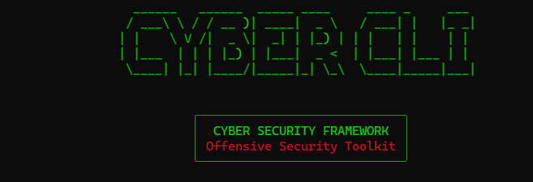

# 🛡️ Cyber Framework



A **modular cybersecurity CLI framework** written in Python designed for reconnaissance, scanning, vulnerability analysis, and automated attack chains.

The framework provides:

- 🟢 **Beginner Mode**: Guided menu-driven interface
- 💻 **Advanced Console Mode**: Metasploit-style interactive CLI
- ⚔️ **Automated Attack Chain**: Multi-stage reconnaissance and scanning workflows
- 📊 **Attack Graph Visualization**: Structural attack surface mapping
- 🗄 **SQLite Findings Database**: Transaction-safe persistence and history tracking
- 📋 **Multi-Format Reporting**: Text, JSON, and XSS-sanitized HTML report exports
- 🛡 **Built-in Safety & Scope Enforcement**: Strict authorization boundaries and opt-in intrusive testing

---

# ⭐ Why Cyber Framework

Most cybersecurity tools focus on a **single capability** such as scanning, exploitation, or reconnaissance.

Cyber Framework integrates multiple phases of a penetration testing workflow into a **single modular CLI environment**, enabling security researchers and students to simulate realistic attack pipelines.

Key objectives of the framework:

- Provide a **Metasploit-style learning platform**
- Demonstrate **attack chain automation** with safety boundaries
- Enable **modular security tool development** with clean contracts
- Provide an **interactive penetration testing console** with TAB auto-completion

This project is designed for:

- Cybersecurity students
- Ethical hackers
- Security researchers
- Developers building offensive and defensive security tools

---

# 🚀 Features

### Core Framework
- ✅ Beginner Mode (interactive guided menu)
- ✅ Advanced Console Mode (interactive CLI with custom prompt)
- ✅ Automatic Module Discovery (dynamic loading from `modules/`)
- ✅ Automated Multi-stage Attack Chain (`Recon` -> `Scan` -> `Web Scan`)
- ✅ Multi-Stage Pipeline Runner (`run pipeline`)
- ✅ SQLite Persistent Scan Database (`cyber_framework.db`)
- ✅ Atomic JSON Results & Session State Storage
- ✅ Real-time Execution Spinners (honest status tracking)

### Interactive Console Experience
- ⌨️ TAB command auto-completion
- 🧠 Syntax-highlighted commands
- 📜 Persistent command history (`data/command_history.txt`)
- 🎯 Dynamic module prompt (`cyber(recon)>`)
- 📖 Built-in Manual Viewer (`man <module>`)

### Security Modules
- 🔍 **recon**: Domain and DNS reconnaissance (`theHarvester` with native DNS fallback)
- 🌐 **scan**: Network port and service scanning (unprivileged `nmap` with native TCP socket scanner fallback)
- 🕸 **web_scan**: Web vulnerability and header inspection (`nikto` with native HTTP security header inspection fallback)
- ⚡ **exploit**: Targeted SQL injection testing (`sqlmap`, strictly requiring explicit intrusive authorization)
- 🧠 **intelligence**: Empirical DNS and network service correlation distinguishing facts from heuristics

### Advanced Capabilities
- 📊 **Attack Graph Generation**: Structural graph showing Target -> Port -> Service relationships (`show graph`)
- 📄 **Multi-Format Reporting**: Generate text, JSON, or styled HTML reports (`report html`)
- ⏱ **Task Scheduler**: Background recurring scans (backed by `apscheduler`)
- 🌍 **Distributed Controller**: Proof-of-concept socket agent for distributed scans (experimental, disabled by default)

---

# 🔐 Security & Safety Architecture

Cyber Framework is designed with explicit defensive controls:

1. **Target Validation**: All targets are strictly validated against injection characters (`;`, `&`, `|`, `` ` ``, `$`, `\n`) and option injection (leading `-` or `/`).
2. **Scope Enforcement**: Configured via `config.json`. Out-of-scope targets are rejected before executing any network operations.
3. **Opt-in Intrusive Testing**: Exploitation actions are **never** executed automatically in default workflows. Intrusive testing requires explicit authorization (`set intrusive true`).
4. **Subprocess Argument Vectors**: Subprocess calls avoid shell string interpolation (`shell=False`) with fixed timeouts to prevent hangs.
5. **Credential Redaction**: Passwords, API tokens, and Basic Auth credentials are automatically scrubbed from runtime logs.

---

# 🏗 Architecture

```
         +-------------------+
         |      main.py      |
         +---------+---------+
                   |
         +---------+---------+
         |                   |
         v                   v
 +---------------+   +---------------+
 | Beginner Mode |   | Advanced CLI  |
 +---------------+   +---------------+
         |                   |
         +---------+---------+
                   |
                   v
            +--------------+
            | Command      |
            | Parser       |
            +-------+------+
                    |
       +------------+-------------+
       |                          |
       v                          v
+---------------+          +---------------+
|  Core Engine  |          |    Modules    |
+---------------+          +---------------+
| Session State |          | recon         |
| Scope Policy  |          | scan          |
| Safe Runners  |          | web_scan      |
| Attack Chain  |          | exploit       |
| Pipeline      |          | intelligence  |
| Attack Graph  |          +---------------+
| Reporting     |
| SQLite DB     |
+---------------+
```

Detailed component descriptions are available in [docs/architecture.md](docs/architecture.md).

---

# 📁 Project Structure

```text
cyber-framework/
├── .github/
│   └── workflows/
│       └── ci.yml             # GitHub Actions CI workflow (Python 3.10-3.12)
├── core/
│   ├── advanced_console.py    # Rich-enhanced interactive console
│   ├── attack_chain.py        # Automated attack chain workflow
│   ├── attack_graph.py        # Attack surface relationship graph
│   ├── command_parser.py      # CLI command dispatch and parameter parser
│   ├── console.py             # Base prompt-toolkit console loop
│   ├── console_style.py       # Console styling and palette tokens
│   ├── database.py            # SQLite connection, migration, and query layer
│   ├── distributed_controller.py # Distributed socket worker controller (experimental)
│   ├── intelligence_engine.py # Target profiling & empirical correlation
│   ├── logger.py              # Log handler with automated secret scrubbing
│   ├── man_viewer.py          # Terminal manual page reader
│   ├── module_info.py         # Metadata registry for tools and commands
│   ├── module_loader.py       # Dynamic module discovery and validation
│   ├── os_detection.py        # OS environment and privilege detection
│   ├── output.py              # Styled output panels and terminal banners
│   ├── pipeline.py            # Multi-stage security assessment pipeline
│   ├── progress_engine.py     # Real-time status execution spinners
│   ├── report.py              # Text, JSON, and XSS-safe HTML report generator
│   ├── scheduler.py           # Background scan job scheduler
│   ├── session_manager.py     # Session target, scope, and intrusive state
│   ├── syntax_highlighter.py  # Prompt-toolkit lexer for CLI commands
│   ├── tool_detection.py      # External binary availability detector
│   └── utils.py               # Target validator, scope policy, and safe runner
├── modules/
│   ├── recon.py               # OSINT & DNS reconnaissance
│   ├── scan.py                # Network port and service scanner
│   ├── web_scan.py            # Web application security inspector
│   ├── exploit.py             # Targeted SQL injection tester (opt-in)
│   └── intelligence.py        # Target intelligence gathering
├── man/
│   ├── attack_chain.man       # Manual page for automated attack chain
│   ├── exploit.man            # Manual page for exploit module
│   ├── intelligence.man       # Manual page for intelligence module
│   ├── recon.man              # Manual page for recon module
│   ├── scan.man               # Manual page for scan module
│   └── web_scan.man           # Manual page for web scan module
├── ui/
│   └── banner.py              # Framework startup banner
├── data/
│   ├── results.json           # Atomic JSON scan findings repository
│   ├── sessions.json          # Persistent session cache
│   └── command_history.txt    # Shell command history
├── docs/
│   ├── architecture.md        # Comprehensive technical architecture
│   └── usage.md               # User guide and command reference
├── tests/                     # Automated test suite (84+ pytest tests)
├── config.json                # Active configuration file
├── config.example.json        # Template configuration file
├── requirements.txt           # Production dependencies
├── requirements-dev.txt       # Development & test dependencies
├── LICENSE                    # MIT License
├── README.md                  # Project overview and documentation
└── main.py                    # Framework entry point
```

---

# ⚙️ Installation

### Prerequisites
- **Python**: 3.10, 3.11, or 3.12
- **Operating System**: Linux (Ubuntu, Debian, Kali, Arch) or Windows (10/11)
- **Git**

### 1. Clone the repository
```bash
git clone https://github.com/Bhuvaneshkumar1/cyber-framework.git
cd cyber-framework
```

### 2. Create and activate a virtual environment
**On Linux / macOS:**
```bash
python3 -m venv venv
source venv/bin/activate
```

**On Windows (PowerShell):**
```powershell
python -m venv venv
.\venv\Scripts\Activate.ps1
```

### 3. Install dependencies
```bash
pip install -r requirements.txt
```

*(Optional) Install development and testing dependencies:*
```bash
pip install -r requirements-dev.txt
```

---

# 🔧 Configuration

The framework loads configuration from `config.json` in the project root:

```json
{
  "scope": {
    "enforce_scope": true,
    "allowed_targets": [
      "localhost",
      "127.0.0.1",
      "::1"
    ]
  },
  "safety": {
    "allow_intrusive_actions": false,
    "subprocess_timeout_seconds": 30
  },
  "logging": {
    "file": "scan.log",
    "redact_secrets": true
  },
  "distributed": {
    "enabled": false,
    "bind_host": "127.0.0.1",
    "bind_port": 9090,
    "auth_token": ""
  }
}
```

- **`scope.enforce_scope`**: When `true`, rejects targets not listed in `allowed_targets`.
- **`safety.allow_intrusive_actions`**: Global safety switch for intrusive modules.
- **`safety.subprocess_timeout_seconds`**: Maximum execution time per external process call.
- **`logging.redact_secrets`**: Automatically masks passwords and API tokens in `scan.log`.

---

# ▶️ Running the Framework

Start Cyber Framework:
```bash
python main.py
```

You will be prompted to select an interface mode:
```text
1. Beginner Mode
2. Advanced Console
```

---

# 🟢 Beginner Mode

Beginner mode provides a menu-driven, guided interface ideal for quick assessments or learning:

1. Select **Beginner Mode**.
2. Enter the target (e.g., `127.0.0.1` or `example.com`).
3. Select an operation:
   - `Recon`
   - `Scan`
   - `Web Scan`
   - `Exploit` *(requires confirmation)*
   - `Attack Chain`
   - `Full Pipeline`

---

# 💻 Advanced Console Mode

Advanced Console Mode provides an interactive shell with tab auto-completion, command history, and dynamic prompts.

### Command Reference

| Command | Arguments | Description |
|---|---|---|
| `help`, `?` | None | Display available console commands |
| `show modules` | None | List all discovered security modules |
| `show options` | None | Display active target, module, and safety status |
| `show info` | `[module]` | View tool metadata and usage for a module |
| `show graph` | None | Visualize the attack surface relationship graph |
| `show scans` | None | Display recorded scan findings from the database |
| `use` | `<module>` | Select and switch into a specific module context |
| `set target` | `<target>` | Set target domain, IP, CIDR, or URL |
| `set intrusive` | `<true\|false>` | Authorize or disable intrusive vulnerability actions |
| `run` | None | Execute the currently selected module |
| `run pipeline` | `[--exploit]` | Run the multi-stage assessment pipeline |
| `run attack_chain` | `[--exploit]` | Execute automated attack chain workflow |
| `report` | `[txt\|json\|html]` | Export assessment report to text, JSON, or HTML |
| `man` | `<module>` | View manual page for a module or workflow |
| `back` | None | Deselect current module and return to main prompt |
| `clear` | None | Clear terminal screen |
| `exit`, `quit` | None | Exit the framework |

### Interactive Walkthrough Example

```text
cyber> show modules
Available Modules:
  - recon
  - scan
  - web_scan
  - exploit
  - intelligence

cyber> set target 127.0.0.1
[+] Target set to: 127.0.0.1

cyber> use scan
cyber(scan)> run
[*] Starting scan against 127.0.0.1...
[+] Discovered open port 80/tcp (http)
[+] Discovered open port 443/tcp (https)
[+] Scan findings saved to database.

cyber(scan)> show graph
Target: 127.0.0.1
  └── Port: 80/tcp (http)
  └── Port: 443/tcp (https)

cyber(scan)> report html
[+] HTML report generated successfully: reports/report_127.0.0.1_20261015.html

cyber(scan)> back
cyber> exit
```

---

# 🧪 Automated Testing

Cyber Framework includes an extensive automated test suite covering target validation, subprocess safety, scope policies, database migrations, atomic I/O, manual pages, and module contracts.

Run the test suite with pytest:
```bash
python -m pytest tests -v
```

All 84+ tests pass across Windows and Linux environments without external tool dependencies.

---

# 🛠 Troubleshooting & Limitations

| Symptom | Cause | Resolution |
|---|---|---|
| `Target out of scope` | Scope enforcement is active in `config.json` | Add the target to `scope.allowed_targets` or set `"enforce_scope": false` in `config.json` for authorized testing. |
| `Exploit module refused` | Intrusive actions disabled by default | Run `set intrusive true` in the console or set `"allow_intrusive_actions": true` in `config.json`. |
| `External tool not found` | `nmap`, `theHarvester`, `nikto`, or `sqlmap` not in PATH | Install external tools or rely on automatic native Python fallbacks for DNS and TCP port scanning. |
| `Port scanning permissions` | Raw SYN scans require administrative privileges on some OS | Cyber Framework defaults to unprivileged TCP connect (`-sT`) scans and native Python socket fallbacks. |
| `Distributed controller` | Socket worker listener not running | The distributed controller is an experimental proof-of-concept disabled by default. Run locally or configure `distributed.enabled` and `auth_token` in `config.json`. |

---

# ⚠️ Disclaimer

This tool is designed **strictly for educational purposes and authorized security assessments**.

Do **NOT** use this tool against targets without prior written authorization from the system owners. The authors and contributors assume no liability for misuse or damage caused by this software.

---

# 🔧 Roadmap & Planned Features

The following capabilities are planned for future major releases:
- Real-time Web UI dashboard
- Async distributed worker node orchestration
- Dynamic CVSS scoring integration
- Automated PDF report exports

---

# 📜 License

This project is licensed under the **MIT License**. See the [LICENSE](LICENSE) file for complete details.

---

# 👨‍💻 Author

**Bhuvaneshkumar** — *Modular Cybersecurity Framework*
